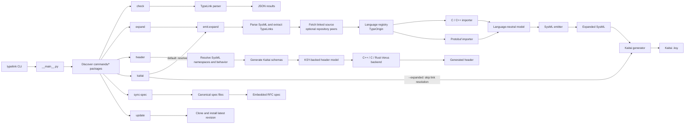

# SysML Remote Type Links

[](LICENSE)
[](spec/RFC.md)
[](spec/RFC.md)

Use SysMLv2 `@TypeLink` annotations to import supported external types and
generate their item bodies. The CLI also generates Kaitai Struct schemas from
imported or native SysMLv2 models, independently of their source format.

## Quick start

Clone with the pinned grammar submodules, then install the tool dependencies:

```sh
git clone --recurse-submodules https://github.com/michaellrowley/sysml-remote-types.git
cd sysml-remote-types
git submodule update --init --recursive && python -m pip install -e ./tool
```

After installation, `typelink` is available on `PATH` from any working
directory (keep the repository checkout in place). For example:

Add a link to a SysMLv2 item:

```sysml
item def packet {
    @TypeLink {
        origin = TypeOrigin::C;
        uri = "https://example.com/packet.h";
    }
}
```

For example, given this `packet.h`:

```c
#include <stdint.h>
struct header { uint8_t type; uint16_t len; };
struct packet { struct header hdr; uint8_t payload[4]; };
```

`typelink expand` generates the members, sizes, source layout kind, and member
offsets:

```sysml
@DataLayout { kind = DataLayoutKind::Struct; }
@DataSize { bits = 64; }
item def header {
    @DataLayout { kind = DataLayoutKind::Struct; }
    @DataSize { bits = 32; }
    attribute 'type' : ScalarValues::Integer {
        @DataSize { bits = 8; }
        @DataOffset { bits = 0; }
        @DataSigned { value = false; }
    }
    attribute len : ScalarValues::Integer {
        @DataSize { bits = 16; }
        @DataOffset { bits = 16; }
        @DataSigned { value = false; }
    }
}
item hdr : header {
    @DataSize { bits = 32; }
    @DataOffset { bits = 0; }
}
attribute payload : ScalarValues::Integer[4] {
    @DataSize { bits = 8; }
    @DataOffset { bits = 32; }
    @DataSigned { value = false; }
}
```

Run the tool to validate links or generate the item's body:

```sh
typelink check model.sysml
typelink expand model.sysml
typelink update
```

`typelink update` clones the latest `main` branch with its grammar submodules
and reinstalls the CLI. Its source checkout is retained under the user cache
(`$XDG_CACHE_HOME/typelink/checkouts` or `~/.cache/typelink/checkouts`) so the
editable installation remains usable after the temporary download is removed.

Expansion writes generated content between `typelink:begin` and `typelink:end`
markers; re-running it replaces that region. Pass a directory to `check` or
`expand` to process its `.sysml` files recursively. `check` combines findings
into its normal JSON output; `expand` rewrites those files in place. See the
[RFC](spec/RFC.md) for the metadata definition, sizing rules, and supported
formats.

## Modular architecture

The CLI discovers command packages independently from the processing pipeline.
Expansion uses a language registry to normalize external source types before
the SysML emitter or Kaitai generator consumes them:



Type importers are similarly isolated under `tool/typelink/languages/`. Each
importer returns the language-neutral model defined in `model.py`; the registry
maps it to a `TypeOrigin` value from `spec/typelink.sysml`. Add the matching
enum literal to `TypeOrigin` and run `typelink sync-spec`, then add an importer
module with `@register("Origin")`, implement `Importer.import_type`, and import
that module from `languages/__init__.py`. Add scalar-width metadata to
`spec/types.json` when the language needs it. Kaitai generation consumes the
normalized SysML model, keeping source-language parsing separate from
output-format generation.

## Generate Kaitai Struct schemas

`typelink kaitai` generates a Kaitai Struct `.ksy` schema from an imported
SysMLv2 item. Generation uses the SysML structure and layout metadata only; it
does not depend on the original source language or format. By default, the
command also resolves `@TypeLink` annotations and expands their items first.
For items without an explicit layout, fields with data types and `@DataSize`
are treated as a packed sequence. Select an item with `--item` when the file
contains more than one top-level item:

```sh
typelink kaitai examples/packet.sysml --item Packet -o packet.ksy
```

Fields inherited through `specializes` definitions are included before the
selected item's directly declared fields. Unresolved or cyclic specialization
is rejected rather than generating a partial schema.

Pass a directory to generate a `.ksy` file for each `.sysml` file recursively.
Schemas are written beside their source files by default; `-o` can instead
name an output directory, where the source directory structure is mirrored.

The checked-in [SysML input](examples/packet.sysml) and
[generated schema](examples/packet.ksy) show the native packed layout. To
generate from a model that was expanded separately, pass `--expanded`:

```sh
typelink expand model.sysml -o expanded.sysml
typelink kaitai expanded.sysml --item packet --expanded -o packet.ksy
```

`DataLayout` distinguishes offset-based structures and overlapping unions from
packed sequences. `DataOffset`, `DataSize`, and `DataSigned` provide the layout
facts needed to generate fields and padding; unions are emitted as opaque byte
regions because the model has no discriminator that selects a member. Tagged
wire layouts can carry `DataEncoding` metadata for field tags, wire kinds,
packed fields, maps, and nested types, allowing the generator to emit a wire
parser rather than treating them as in-memory structures.

`--endian le|be` and `--bit-endian le|be` control byte and bit order for
layouts that do not define their own encoding (both default to little-endian).
`--integer-signedness` chooses `signed` or `unsigned` for `Integer` fields
without `DataSigned` metadata (default unsigned). Protocol-defined encodings
retain their required byte and bit order. The generated tagged-wire `fields`
array preserves wire order; consumers interpret a field by its tag. See
`typelink kaitai --help` and the
[RFC](spec/RFC.md#7-kaitai-generation) for the complete mapping and
limitations.

For other import settings, run `typelink expand` first (for example,
`typelink expand model.sysml --data-model MODEL -o expanded.sysml`), then
generate from the resulting SysMLv2 with `typelink kaitai --expanded`.

## Generate source headers and Rust modules

`typelink header` translates SysML item definitions and `action def` behaviors
into declarations for the selected language backend. It resolves `@TypeLink`
annotations by default; pass `--expanded` for a model that was expanded
separately:

```sh
typelink header examples/packet.sysml -o packet.hpp --expanded
typelink header model.sysml --language c -o model.h
typelink header model.sysml --language rust -o model.rs
typelink header model.sysml --declarations-only -o model.hpp
```

The `cpp` backend emits C++17. Generated Kaitai schemas are the source of truth
for record fields, primitive widths, repeats, nested types, and layout
constants; SysML supplies namespaces, inheritance, and behavior declarations.
Item inheritance becomes public struct inheritance; fixed, optional, and
unbounded multiplicities are represented by `std::array`, `std::optional`, and
`std::vector` where present in the schema. Nested item definitions remain
nested types, and package nesting becomes C++ namespaces. The `c` backend emits
C11: it flattens package/type names into C identifiers, models inheritance
through an embedded base member, and uses C arrays or pointer/length members
for multiplicities; optional values use a `has_value`/`value` wrapper. The
header generator resolves a language-neutral declaration model before calling
a backend, so additional output languages can be registered without coupling
their renderers to SysML parsing.

The `rust` backend emits a Verus-compatible `verus!` module containing Rust
item structs, symbolic enums, and action-signature traits. Enum values do not
receive an implicit numeric representation. Fixed-width fields follow the
Kaitai schema and retain bit-layout constants; Rust package names become
modules, and fixed, optional, and unbounded multiplicities use arrays,
`Option`, and `alloc` collections. A `no_std` consumer must expose the `alloc`
crate when generated fields need heap-backed strings or collections. Rust
action traits are declarations only; executable behavior and its contracts
belong to the middleware layer.

Generated C++ classes contain a nested `kaitai_layout` descriptor with
`static constexpr` size and field offset/width values derived from the
generated Kaitai schema. Descriptors inherit metadata from generated base
classes. The C backend emits equivalent compile-time preprocessor constants,
and the Rust backend emits associated constants on each generated item type.
These values describe the Kaitai schema layout; they are not an in-memory
serialization or Kaitai runtime parser.

By default, `typelink header` runs the full precursor pipeline: it resolves
`@TypeLink` annotations, generates Kaitai schemas, then writes the requested
source file. Those same schemas determine the generated record members. The
`.ksy` files are written beside their matching source files (or mirrored in the
`-o` directory); if a model contains multiple root items, each schema gets an
item-qualified filename. Use `--skip-kaitai` to omit writing `.ksy` sidecars;
schemas are still generated internally to determine record fields. `--expanded`
skips only TypeLink expansion. Empty item definitions need no schema and remain
empty declarations in the generated output. When source is written to stdout,
`.ksy` sidecars are written beside the input SysML file unless skipped.

Action `in` parameters become function inputs. In C++, a single `out`
parameter becomes the function return value and other outputs are references.
In C, output and `inout` parameters are pointers. Generated function bodies
are stubs and include `TODO` annotations for SysML action succession
connections; they intentionally do not implement execution order or runtime
behavior. In Rust, inputs become method arguments, a single `out` value becomes
the return type, and multiple outputs become a tuple.

Use `--declarations-only` when action implementations live in separate source
files. It emits ordinary C++ function declarations or C prototypes, without
inline stub bodies or `TODO` annotations. The default continues to emit stubs
for existing callers. The Rust backend always emits declarations, so the flag
does not change its output.

Pass a directory to process `.sysml` files recursively, like `typelink kaitai`.
Generated source files and schemas are written beside source files by default,
or mirrored beneath the directory named by `-o`. `typelink header --help` lists the
available backends and import options.

The optional TypeLink expansion step reads only the linked file by default.
`--max-bytes` caps the fetched resource; `--clone-repo` also indexes tracked
files from its repository when resolving types. The temporary checkout is
removed afterward and submodule contents are excluded. Repository indexing
does not run compilers or infer build-target include paths. The Python
`emit.expand` API also accepts `clone_repo=True` and `additional_sources` for
callers that manage source context themselves.

## Grammar dependencies

The grammars are pinned submodules in `tool/third_party/`. If you cloned
without `--recurse-submodules`, initialize them with
`git submodule update --init`. SysMLv2's generated parser is committed in
`tool/typelink/_sysml/`; rebuild it with `tool/regen_grammar.sh`. The C/C++
source import grammars are compiled on first use with `cc`; Kaitai generation
does not use them.

## Extending the CLI

CLI commands are discovered from packages under `tool/typelink/commands/`.
To add one, create a directory such as `commands/my_command/` with an
`__init__.py` that defines `register(subparsers)`. Add its parser there and set
`command_handler` to the package's handler function. The command is then
available as `typelink my-command` without editing the CLI dispatcher or a
central command list. Use a hyphenated parser name when the package name uses
underscores, as with `sync_spec` / `sync-spec`.
